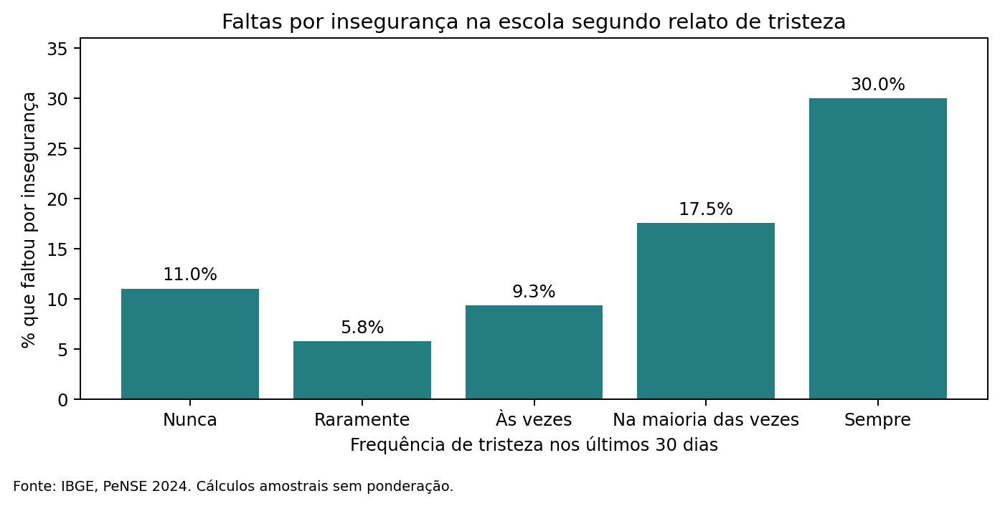
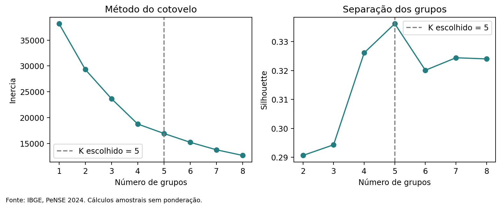
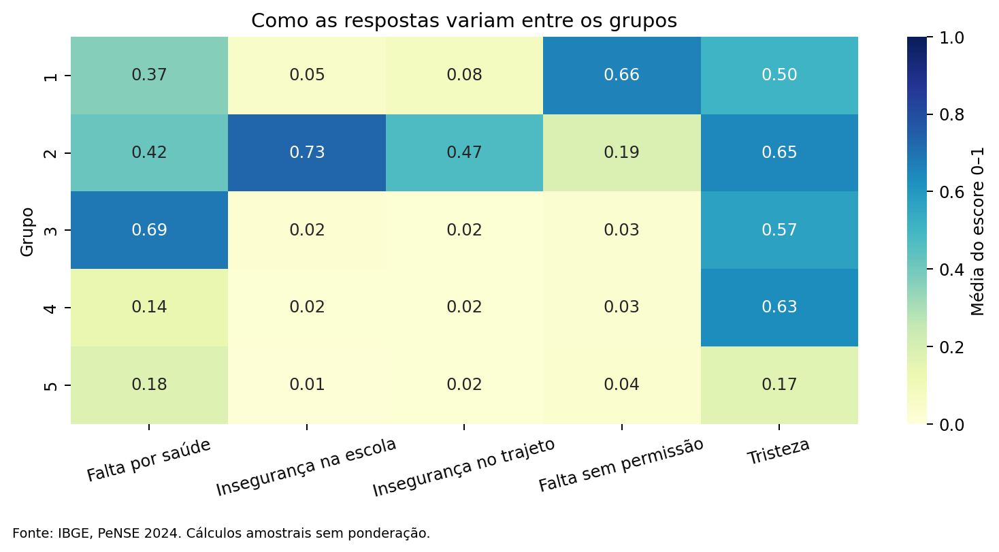

## Introdução, justificativa e objetivos

Quais experiências de saúde, segurança e bem-estar aparecem juntas entre escolares que relatam faltas? Uma ausência por doença, o receio de ir à escola e uma falta sem permissão podem interromper a frequência por motivos distintos. Distinguir esses relatos é relevante para discutir permanência escolar sem classificar um estudante como evadido a partir de uma falta.

O estudo investiga estudantes brasileiros participantes da PeNSE 2024. Busca identificar perfis de respostas com K-Means, descrever sua composição e medir associações entre relatos de faltas e características educacionais, familiares e emocionais. A evasão motiva a pergunta de pesquisa. O desfecho observado é o absenteísmo autorrelatado.

## Revisão da literatura

A análise histórica da PeNSE pelo IBGE (2022) discute como a insegurança na localidade da escola se relaciona ao absenteísmo. A publicação de 2024 distingue insegurança no trajeto e dentro da escola (IBGE, 2026). Essa distinção orienta a seleção de dois quesitos e permite investigar se ambos caracterizam os mesmos grupos.

O K-Means minimiza a soma das distâncias quadráticas dos registros aos centros de seus grupos (Lloyd, 1982). A Silhouette compara a proximidade de um registro ao próprio grupo e ao grupo vizinho mais próximo (Rousseeuw, 1987). O Apriori usa a propriedade de que todo subconjunto de um conjunto frequente também precisa ser frequente (Agrawal e Srikant, 1994). Neste trabalho, o primeiro método resume padrões multivariados e o segundo quantifica associações direcionadas entre duas respostas.

## Metodologia e base de dados

O arquivo oficial PENSE2024_MICRODADOS.csv contém 153.870 registros e 430 colunas. O domínio IND_EXPANSAO igual a 1, identificado no exemplo de análise que acompanha os microdados, contém 148.736 registros. O código lê seletivamente as nove perguntas e os campos de controle. O estudo descreve a amostra brasileira com frequências simples. Estimativas populacionais e intervalos de confiança exigiriam o desenho amostral complexo.

| Código | Atributo | Uso |
|---|---|---|
| B13006 | Dias de falta por saúde em 12 meses | Agrupamento e regras |
| B09002 / B09001 | Faltas por insegurança na escola / no trajeto em 30 dias | Agrupamento e regras |
| B07001 | Faltas sem permissão em 30 dias | Agrupamento e regras |
| B12005 | Frequência de tristeza em 30 dias | Agrupamento e regras |
| B01021B / B01026A2 | Série / planos após o ensino médio | Contexto e regras |
| B01006 / B01007 | Mora com mãe / pai | Contexto e regras |

## Pré-processamento

A chave formada por estrato, escola, turma e aluno foi completa e única. Mantiveram-se respostas iguais de estudantes diferentes. Para cada pergunta, o código verificou as categorias no dicionário antes de separar pulo (−1, quando previsto), abandono do questionário (−2), sem resposta (−9) e célula vazia. Por exemplo, a pergunta de planos após o ensino médio teve 46 pulos, 17 abandonos e 77 registros sem resposta no domínio.

A ausência por item variou de 0,04% a 1,12%. Para evitar criar respostas por imputação, selecionaram-se casos completos separadamente em cada técnica. Restaram 146.099 estudantes para os cinco itens ativos do K-Means e 145.915 para os nove itens do Apriori. A exclusão pode favorecer participantes que completaram o questionário. A categoria modal da insegurança no trajeto reuniu 89,54% das respostas válidas. Manteve-se a pergunta pela relevância das faltas registradas na categoria minoritária.

## Análise exploratória

Entre os pares válidos de tristeza e falta por insegurança na escola, relataram pelo menos uma falta 11,0% dos que nunca sentiram tristeza, 5,8% dos que raramente a sentiram, 9,3% dos que a sentiram às vezes, 17,5% dos que a sentiram na maioria das vezes e 30,0% dos que sempre a sentiram. Os dois primeiros valores mostram que a relação não cresce a cada passo da escala. Cada barra usa como denominador os respondentes da respectiva categoria.

{width=86%}

## Clusterização

As cinco escalas ordenadas foram convertidas para o intervalo de 0 a 1 pela amplitude teórica. O procedimento evita que uma pergunta com mais categorias domine apenas por sua escala, mas assume igual distância entre categorias adjacentes. Os centros expressam intensidade relativa na escala. Série, planos e convivência familiar descrevem os grupos após o ajuste, evitando impor uma ordem de vulnerabilidade a respostas nominais.

Ajustaram-se modelos de K = 1 a 8 com 20 inicializações e semente 42. Os 2.996 padrões distintos receberam peso igual à sua multiplicidade para preservar a função objetivo de todos os 146.099 casos. Apenas a Silhouette foi aproximada em uma amostra aleatória simples fixa de 2.000 estudantes para limitar o custo das distâncias entre pares.

{width=91%}

A maior Silhouette foi 0,336 em K = 5, próxima de 0,326 em K = 4. A inércia caiu 20,7% de três para quatro grupos e 9,7% de quatro para cinco. O cotovelo favorece considerar quatro grupos; a escolha de cinco segue o critério definido de maximizar a Silhouette. A pequena diferença e o valor absoluto indicam sobreposição. A interpretação depende da escala, da amostra de avaliação e da faixa de K testada.

{width=94%}

| Grupo | Estudantes | Leitura dos centros na escala de 0 a 1 |
|---|---:|---|
| 1 | 7.064 | Maior escore de falta sem permissão (0,66). |
| 2 | 8.308 | Maiores escores de falta por insegurança na escola (0,73) e no trajeto (0,47). |
| 3 | 31.101 | Maior escore de faltas por saúde (0,69), com pouca falta por insegurança. |
| 4 | 57.055 | Poucas faltas nas quatro dimensões e tristeza relativamente frequente (0,63). |
| 5 | 42.571 | Poucas faltas e menor escore de tristeza (0,17). |

A variável que mais diferenciou os centros foi a falta por insegurança na escola: 71,2% da variância do seu escore ficou entre grupos. Essa fração descreve a partição construída com a própria variável. Os grupos 4 e 5 ilustram por que uma frequência de faltas baixa pode coexistir com experiências emocionais diferentes.

## Regras de associação

Cada estudante completo gera uma transação. Os itens representam categorias do questionário. Os quatro motivos de falta foram recodificados como ocorrência de pelo menos um dia, e a tristeza frequente reuniu “na maioria das vezes” e “sempre”. A pergunta sobre saúde cobre 12 meses; as demais faltas e a tristeza cobrem 30 dias. Não se somaram dias nem se presumiu que duas faltas ocorreram na mesma data.

Aplicou-se o Apriori até conjuntos de dois itens, podando itens individuais infrequentes antes de contar pares. Os antecedentes possíveis são contextuais e o consequente é a presença de uma falta específica. Essa direção evita regras inversas duplicadas e a associação quase tautológica entre recodificações da mesma pergunta. Não houve amostragem nesta etapa.

Suporte é a proporção das transações que contêm ambas as respostas. Confiança é a proporção com o consequente entre as transações com o antecedente. Lift divide a confiança pela frequência do consequente no conjunto. O filtro principal exige suporte mínimo de 2%, confiança mínima de 20% e lift de pelo menos 1,10. Esses limites exploratórios privilegiam combinações presentes em milhares de registros e com diferença relativa interpretável. Com confiança fixa em 20%, elevar o suporte de 1% para 2% e depois 5% reduziu as regras de oito para sete e três. Com confiança de 30%, nenhuma passou pelos demais filtros.

| Antecedente | Falta relatada | Suporte | Confiança | Lift |
|---|---|---:|---:|---:|
| Tristeza frequente | Insegurança na escola | 6,12% | 21,4% | 1,78 |
| Planeja somente trabalhar | Sem permissão | 2,24% | 27,3% | 1,47 |
| Não mora com a mãe | Sem permissão | 2,49% | 25,1% | 1,35 |

## Resultados, discussão e limitações

Na regra de maior lift, 8.931 participantes relataram simultaneamente tristeza frequente e falta por insegurança na escola. Entre os que relataram tristeza frequente, a proporção de falta foi 21,4%, ante 12,0% no conjunto das transações. A diferença é de cerca de 9,4 pontos percentuais. O lift de 1,78 expressa uma frequência relativa 78% maior. A direção da seta define o denominador e não estabelece uma sequência temporal.

O resultado sobre planos de somente trabalhar descreve uma intenção após concluir o ensino médio. Interpretá-la como intenção de abandonar os estudos antes de concluir o curso alteraria o sentido da pergunta. Do mesmo modo, morar com um responsável descreve composição domiciliar, sem medir qualidade do cuidado. As regras são bivariadas, sem ajuste para idade, renda ou outros fatores.

A amostra inclui escolares alcançados pela pesquisa. Quem já saiu da escola ou faltou no momento da coleta pode ter experiências diferentes. Autorrelato, janelas de referência distintas e exclusão de casos incompletos restringem as conclusões. O desenho transversal não permite estabelecer se tristeza precedeu as faltas ou vice-versa.

## Conclusão

Os dados distinguem perfis de faltas por saúde, por insegurança e sem permissão. A presença simultânea de insegurança na escola e no trajeto no grupo 2 dialoga com a análise do IBGE sobre os dois contextos de segurança. O contraste entre os grupos 4 e 5 acrescenta que estudantes com poucas faltas também podem relatar tristeza frequente. O uso apropriado desses resultados é orientar perguntas sobre frequência e acolhimento escolar. Para investigar evasão efetiva, seria necessário acompanhar matrículas e desligamentos ao longo do tempo.

## Referências

AGRAWAL, R.; SRIKANT, R. Fast Algorithms for Mining Association Rules in Large Databases. VLDB, 1994, p. 487–499. [Publicação](https://www.vldb.org/dblp/db/conf/vldb/vldb94-487.html).

IBGE. Pesquisa nacional de saúde do escolar: análise de indicadores comparáveis dos escolares do 9º ano do ensino fundamental, 2009/2019. Rio de Janeiro, 2022. [Publicação](https://svs.aids.gov.br/daent/cgdnt/pense/analise-comparativa-2009-2019.pdf).

IBGE. Pesquisa Nacional de Saúde do Escolar 2024. Rio de Janeiro, 2026. [Resultados da pesquisa](https://agenciadenoticias.ibge.gov.br/media/com_mediaibge/arquivos/dbff6312ead43646734c2b1f9258b7d9.pdf). [Microdados, dicionário e exemplos de desenho amostral](https://ftp.ibge.gov.br/pense/2024/microdados/).

LLOYD, S. Least squares quantization in PCM. IEEE Transactions on Information Theory, v. 28, n. 2, p. 129–137, 1982. DOI 10.1109/TIT.1982.1056489.

ROUSSEEUW, P. J. Silhouettes: a graphical aid to the interpretation and validation of cluster analysis. Journal of Computational and Applied Mathematics, v. 20, p. 53–65, 1987. DOI 10.1016/0377-0427(87)90125-7.
